<p align="center">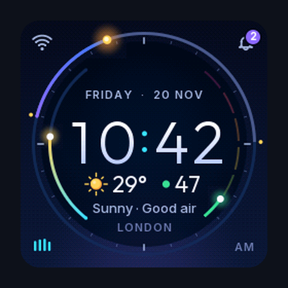</p>

<h1 align="center">CAIDEN OS</h1>

<p align="center">
Open firmware for the <b>CAIDEN Smart Weather Clock</b>, the small white cube with a 240×240 colour screen.<br>
Weather, air quality, Spotify, news, markets, live cricket and focus timers, set up from your phone<br>
and updated over the air from anywhere.
</p>

> **Unofficial.** This project isn't made or supported by the CAIDEN brand. Installing it replaces the clock's
> stock firmware. Back the stock firmware up first ([guide](docs/BACKUP_AND_RESTORE.md)) so you can always
> go back. You do this at your own risk.

## Contents

- [What's new](#whats-new)
- [Screens](#screens)
- [Features](#features)
- [How it works](#how-it-works)
- [What you need](#what-you-need)
- [Install](#install)
- [Settings page](#settings-page)
- [Lyrics](#lyrics)
- [Mining (hobby)](#mining-hobby)
- [Updates](#updates)
- [Security and privacy](#security-and-privacy)
- [Troubleshooting](#troubleshooting)
- [Project layout](#project-layout)
- [Credits and licence](#credits-and-licence)

## What's new

The latest firmware is **1.1.3**. Clocks on 0.7.8 or newer update over the air from the System tab; older ones need one USB flash.
Lyrics also need the updated relay (`relay/worker.js`): redeploy it with `npx wrangler deploy` in `relay/`.

### Lyrics page: "Kinetic Poster" (new in 1.1.0)

<p align="center">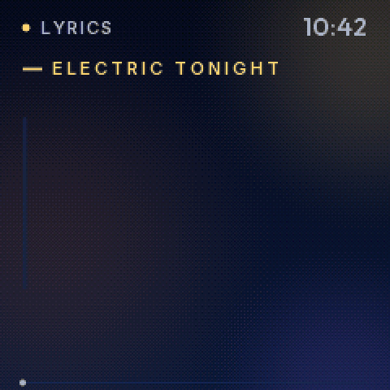</p>

The song playing on Spotify, sung line by line on the clock and set like a small animated music poster:
- **The sung line is the centrepiece.** It is left-aligned in rows that read as phrases ("Neon rain / is falling /
  on the street"). Content words are set in a heavy hero face and small words ("is", "on the") in a lighter one
  on the same baseline. Lines of one to three words get one word per row with a stepped indent.
- **Word by word, but only when it's real.** Many songs on [LRCLIB](https://lrclib.net) have a start time for
  every word. For those, the word being sung turns album-coloured with a short underline and a small pop. Sung
  words turn white and coming words wait dimmer. Songs with line timing only show the whole line without
  singling out any word: the clock never guesses word timing.
- **Motion:** when a line changes, the old one lifts away and the new words land one after another, all
  within 300 ms. The line before sits faded above and the next line peeks in at the bottom. A slim rule on the
  left fills as the line is sung.
- **Gaps and intros:** a point of light travels along a hairline for the length of the gap, with
  "BACK IN 3".
- **Album colours:** the two main colours of the album art tint the background, the rule and the sung word.
  Dull or dark colours are brightened automatically so text stays readable.
- **No lyrics, or an instrumental:** the song title becomes the poster, with rhythm bars underneath. No words are
  invented.
- **Paused:** the line stays, dimmed, under a PAUSED mark.

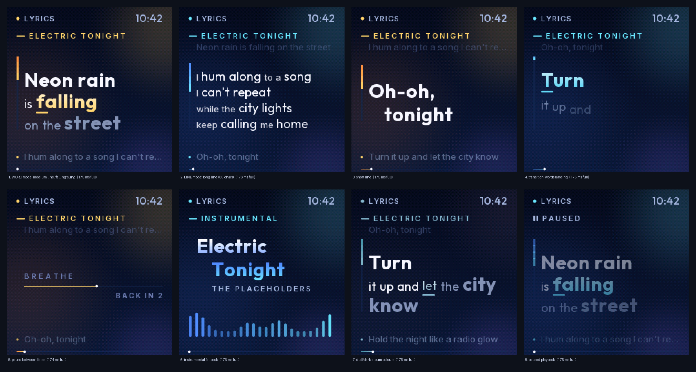

See [Lyrics](#lyrics) for how it works, its limits and how the design was chosen.

### Spotify page only while music plays (0.9.9)

The Spotify page joins the rotation only while something is playing. The "Nothing playing" screen no longer
comes up between other pages.


### Mining page: the crystal mine

<p align="center">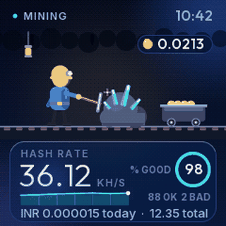</p>

A tiny crystal mine, drawn live by the clock:
- **The cave:** a hanging lantern, a rocky ceiling with stalactites, rails with wooden sleepers, and a mine cart.
- **The miner:** rosy cheeks, blinking eyes and a helmet lamp whose beam lights up the ore. He swings faster as
  the hash rate rises, and the pickaxe leaves motion-blur ghosts.
- **The ore:** faceted crystal shards that shimmer and twinkle, and flash on every strike. Each impact throws
  sparks and rock chips.
- **Accepted share:** a coin with a trail flies out of the ore into the cart, the cart bounces, and "+1" floats
  up. The pile of coins in the cart grows over the session.
- **Rejected share:** he says "Oops - bad share".
- **Paused:** he sits down and dozes ("Zzz"), and his speech bubble says why ("Low memory", "Finding a pool...").

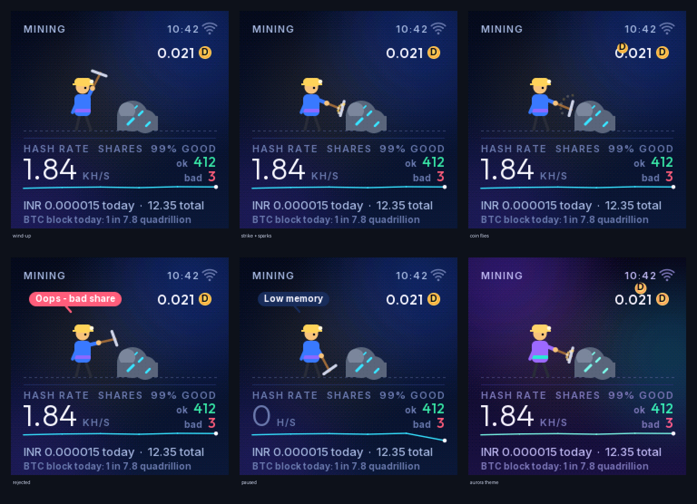

Below the scene, a glass card shows:
- the hash rate in gradient digits;
- an acceptance ring (percentage of good shares) and the share counts;
- a filled 24-hour hash-rate chart;
- a ticker that alternates every 5 seconds between today's INR value with your DUCO total, and the odds of
  this clock finding a Bitcoin block today.

The pill at the top shows DUCO earned today. The page follows the theme, including the light Crystal theme:

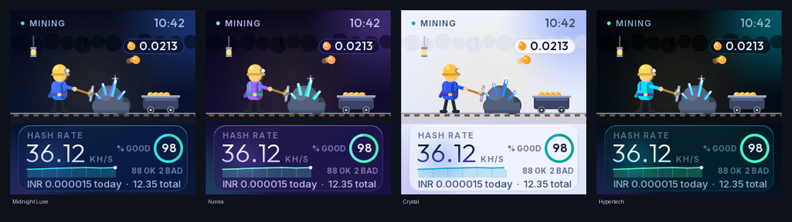

While animating, only the swinging arm redraws, 4 times a second, plus the sparks during an impact, the ore's
shimmer once a second, and the coin's path and the cart when a share lands. Each frame costs about 17 ms, so
mining keeps its full speed (about 40 kH/s, measured) even while this page is on screen.

### Badges in every page header


While mining is on, a small gold pickaxe taps in the header of every page. It turns grey while mining is paused.
It sits next to the Spotify equaliser, which still shows whenever music plays. On Home, both appear in the
bottom-left corner.

The header lays out right to left: the time (or LIVE, or how old the data is), then the badges, then the page
title, which gets shortened with "…" if it doesn't fit. Nothing overlaps.

### Home network page and a password on the clock

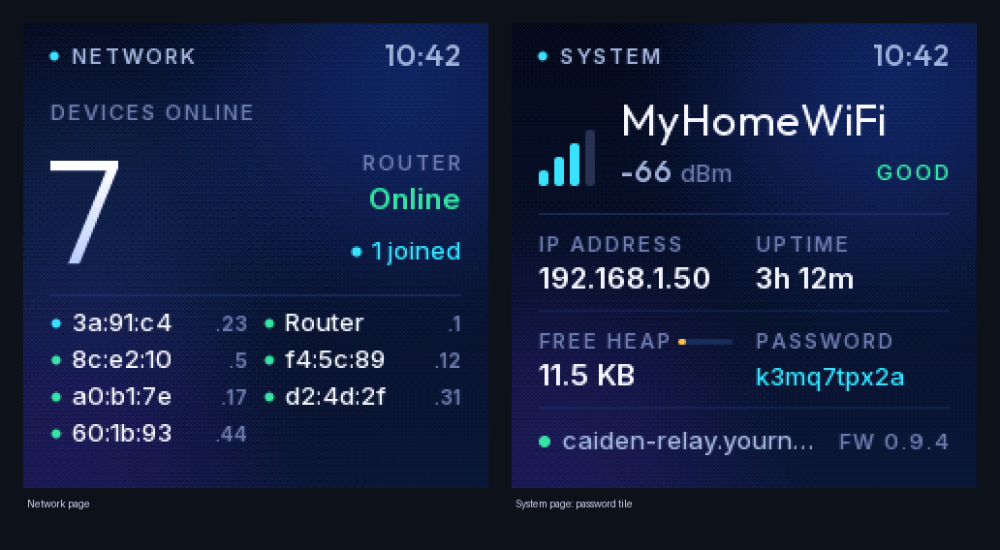

- **Network page:** how many devices are on your network right now, whether the router answers, devices that
  joined since the clock started, and up to 8 devices by the end of their MAC address. The clock finds them
  itself every 5 minutes; nothing leaves your network.
- **System page:** now shows the settings-page **password** that the clock made, in place of "Last sync".

### Settings page: Mining and Password cards

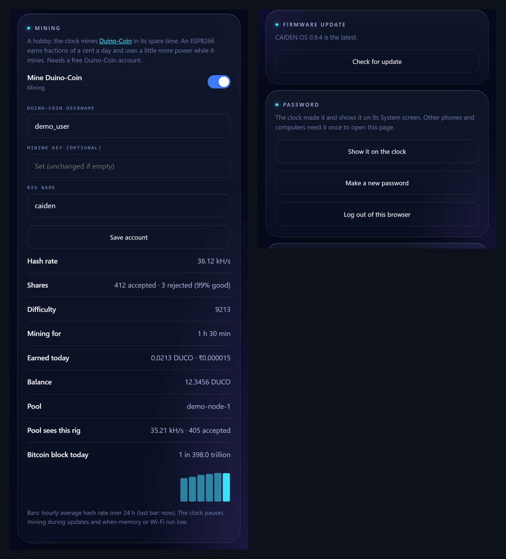

- **Mining card** (Feeds tab):
  - switch it on and add your Duino-Coin account;
  - live hash rate, shares, difficulty and earnings;
  - what the pool itself sees for your rig;
  - the Bitcoin odds and a 24-hour chart.
- **Password card** (System tab): show the password on the clock, make a new one (logs out every other browser),
  or log out of this browser.

### Faster and leaner

| | Before | Now |
|---|---|---|
| Mining speed (real, in the clock's spare time) | not measured, and every share rejected (0.8.7) | **33–39 kH/s**, almost no rejects |
| Mining code speed while hashing | generic SHA-1 | **54.7 kH/s**: one-block kernel, precomputed rounds, in fast IRAM |
| Free memory on the clock | 10.5 KB | **12.0 KB** (183 log and format strings moved to flash) |
| Freeze each Spotify check (every 5 s while playing) | about 0.6 s | **none**: the reply is read in the background |
| Cloud update download | 161 s | **about 40 s** |

### Other changes

- **News:** Google News started blocking Cloudflare, so the relay now reads BBC and The Hindu RSS for topics and
  Bing News for your own searches.
- **Health report:** `http://<your relay>/clock.json` shows the version, uptime, memory, Wi-Fi signal, last
  restart reason, the last update error, and mining speed and shares, so you can check the clock without USB.
- **Connection page removed:** its "speed" was the clock's own link, never your internet line.
- **Home screen:** the conditions line ("Clear · Moderate air") fits inside the air-quality ring.

<details>
<summary>Version history</summary>

| Version | Change |
|---|---|
| 1.1.3 | Lyrics never run past the right edge: rows are measured, too-wide lines step down a font size, and a word still too long ends with "..." |
| 1.1.2 | While a song plays, Spotify stays 3 rotation steps and Lyrics stays until the song ends (5 minutes at most) |
| 1.1.1 | Fixed a crash when the Lyrics page laid out a line (a flash string read the wrong way) |
| 1.1.0 | Lyrics redesigned as the "Kinetic Poster": real word-by-word timing where the provider has it, poster typography, new Outfit 28 hero font; relay sends word timings |
| 1.0.0 | First Lyrics page: synced lyrics from LRCLIB through the relay, romanised fallback for non-Latin scripts |
| 0.9.9 | Spotify page shows only while music is playing |
| 0.9.8 | Mining page redraws far less (17 ms per frame instead of 100-160 ms): mining keeps ~40 kH/s while it's shown |
| 0.9.7 | Mining page: nothing overflows (share counts, ring percentage, speech bubble, cave ceiling) |
| 0.9.6 | Mining page redesigned: the animated crystal mine |
| 0.9.5 | The Mining card's 24-hour chart shows (it stayed hidden) |
| 0.9.4 | Faster mining kernel, 15 ms mining slices on still pages, `minebench` USB command, quieter pickaxe badge |
| 0.9.2 | Spotify checks no longer freeze the clock |
| 0.9.1 | 183 strings moved from RAM to flash: about 1.5 KB more free memory |
| 0.9.0 | One-block SHA-1 mining kernel in IRAM: 20–33 kH/s real rate |
| 0.8.9 | Mining pickaxe badge in every header; header lays itself out so nothing overlaps |
| 0.8.8 | Animated miner page; fixed every share being rejected ("Modified hashrate") |
| 0.8.7 | Duino-Coin hobby miner (off by default) and the Mining card |
| 0.8.6 | Home network page (device count) |
| 0.8.5 | Connection page removed |
| 0.8.4 | Health report at `/clock.json` |
| 0.8.3 | Settings-page password made by the clock, shown on the System page |
| 0.8.2 | Fixed the status reply sometimes being cut off |
| 0.8.1 | Conditions line on Home fits inside the gauge |
| 0.8.0 | Faster cloud updates |
</details>

## Screens

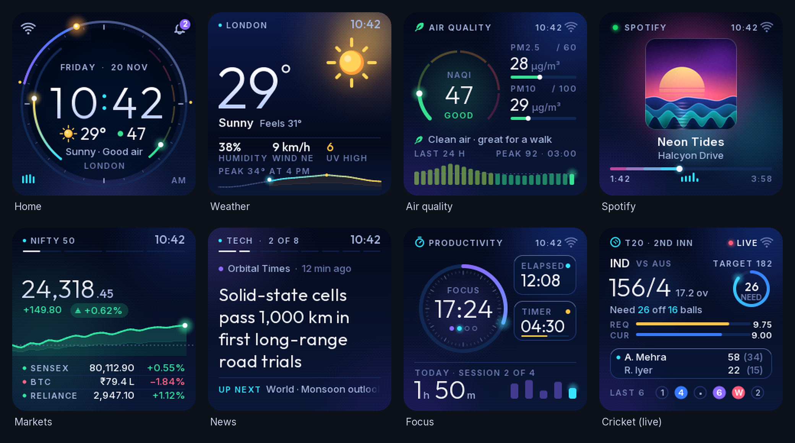

Four themes: Midnight Luxe, Aurora, Crystal and Hypertech.

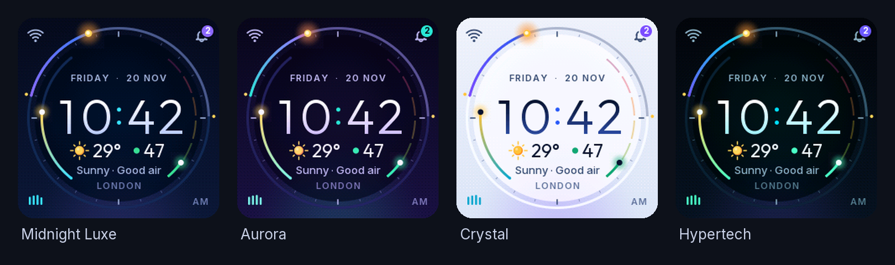

The settings page on your phone (`http://caiden.local`), from left to right: the lock screen, Home, Display and Feeds.

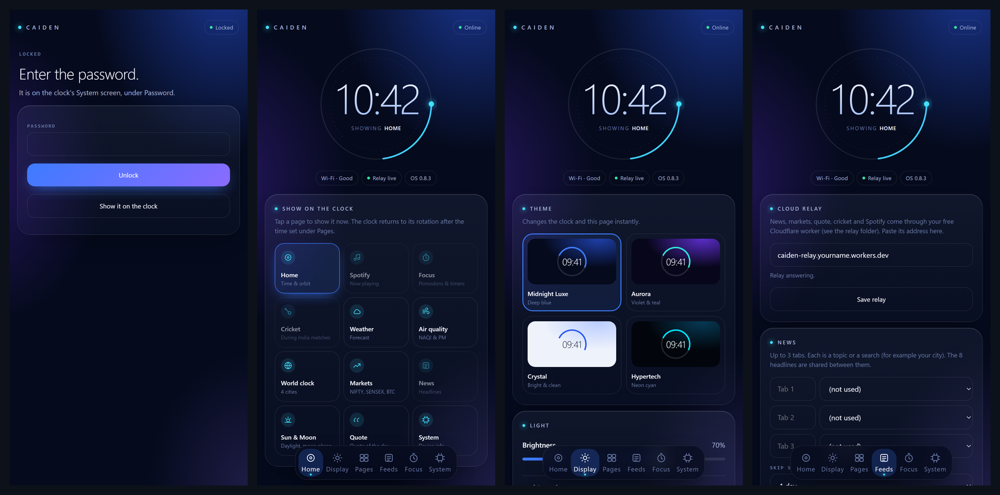

<sub>Clock images are renders from the CAIDEN design simulator, which uses the same drawing maths and fonts as
the firmware; the clock looks very close to them. Sample data is shown.</sub>

## Features

- **Home:** large clock with a sun-path ring (sunrise, sunset, the sun's position now), date, temperature,
  air quality, conditions and your city.
- **Weather:** temperature, feels-like, humidity, wind, UV and today's curve. From
  [Open-Meteo](https://open-meteo.com/); no account or key needed.
- **Air quality:** NAQI with PM2.5 and PM10, plus a 24-hour history.
- **Sun & Moon:** daylight arc and moon phase.
- **World clock:** London, New York, Tokyo and Dubai.
- **Spotify:** track, artist, album art and progress. Shows only while something is playing; an animated
  equaliser appears in every page's header while music plays.
- **Lyrics:** the playing song's lyrics, in time with the music, as an animated typographic poster; word by word
  where the timing exists. From [LRCLIB](https://lrclib.net) through your relay; no account or key. See
  [Lyrics](#lyrics).
- **News:** up to 3 tabs, each a topic (world, India, business, technology, science, sport, health,
  entertainment) or your own search (for example your city).
- **Markets:** up to 4 Yahoo Finance symbols (NIFTY, SENSEX, stocks, ...) plus Bitcoin.
- **Cricket:** live scores of the team you follow, shown only while it plays. Free, with an optional key for
  overs and match status.
- **Quote of the day.**
- **Mining (hobby, off by default):** mines [Duino-Coin](https://duinocoin.com) in the clock's spare time at
  about 30–40 kH/s, with an animated crystal mine, share results, a 24-hour history, earnings and a tongue-in-cheek
  "Bitcoin lottery". A small pickaxe in every header shows it's running. See [Mining](#mining-hobby).
- **Network:** how many devices are on your network right now, the router, and new arrivals. The clock
  scans its own network every 5 minutes; nothing leaves your network.
- **Focus:** Pomodoro, countdown timer and stopwatch, controlled from your phone.
- **System:** Wi-Fi signal, IP address, uptime, free memory and the settings-page password.
- **Four themes**, brightness, ambient glow, 12/24-hour clock, night screensaver, page rotation (choose pages
  and timing).
- **Over-the-air updates from anywhere**, signed with your clock's own key; you press Install.
- **Password-protected settings page** (the clock makes the password and shows it on its screen).
- **Health report**: check version, memory and signal from anywhere, without USB.

## How it works

```
                        plain HTTP                           HTTPS
   ┌─────────────┐  ───────────────────►  ┌──────────────────────────┐  ──────►  BBC, Bing News, Yahoo Finance,
   │ CAIDEN OS   │                         │ Your cloud relay         │           CoinGecko, ZenQuotes, Spotify,
   │ (the clock) │  ◄───────────────────   │ Cloudflare Worker (free) │  ◄──────  LRCLIB, Cricinfo, updates
   └─────────────┘                         └──────────────────────────┘
      │      ▲
      │      │  http://caiden.local (password)       Open-Meteo: weather & air quality (plain HTTP, direct)
      ▼      │
   your phone or PC on the same Wi-Fi
```

The clock (an ESP8266 with about 11 KB of free memory) can't do HTTPS. Weather comes straight from
Open-Meteo over plain HTTP. Everything else goes through **your own relay**: a small Cloudflare Worker on your
free Cloudflare account that fetches the data over HTTPS and hands it to the clock. There is no shared server
and no PC needs to stay on. The clock works on any Wi-Fi: home, office or a phone hotspot.

## What you need

- A CAIDEN Smart Weather Clock (ESP8266EX, 4 MB flash, CH340C USB; see [docs/HARDWARE.md](docs/HARDWARE.md))
- A USB-C **data** cable (for the first install only)
- A computer with [Python 3](https://www.python.org/) and [PlatformIO Core](https://platformio.org/install/cli)
- 2.4 GHz Wi-Fi (the clock has no 5 GHz)
- For news, markets, Spotify, cricket and remote updates: a free [Cloudflare](https://dash.cloudflare.com/sign-up)
  account and [Node.js](https://nodejs.org/)

Install esptool (it brings pyserial with it):

```
python -m pip install esptool
```

## Install

### 1. Back up the stock firmware

Follow [docs/BACKUP_AND_RESTORE.md](docs/BACKUP_AND_RESTORE.md). It takes about 15 minutes, and it is the
only way back to the stock firmware. Keep the backup private: it contains your Wi-Fi password.

### 2. Build and flash CAIDEN OS (USB, once)

```
git clone https://github.com/<you>/<this-repo>.git
cd <this-repo>/firmware
python -I tools/gen_portal.py
pio run -e caiden
python -m esptool --port PORT --baud 115200 write-flash 0x0 .pio/build/caiden/firmware.bin
```

Replace `PORT` with the clock's port (for example `COM5`, `/dev/ttyUSB0` or `/dev/cu.wchusbserial*`; see the
backup guide). Use 115200 baud; faster speeds are unreliable on this clock. The first boot takes a few seconds
longer, because the clock sets up its storage.

### 3. Connect it to Wi-Fi

With no Wi-Fi saved, the clock starts its own setup network and shows its name and password on screen.

**Option A, phone:** join the network shown on the clock (`CAIDEN-xxxx`, password on the screen), open
`http://192.168.4.1`, then pick your Wi-Fi, enter its password, your city and time zone, and save. The clock
restarts and joins your network.

**Option B, USB:** keep the clock plugged in and run, from `firmware/`:

```
python tools/usb_setup.py
```

It asks for your Wi-Fi name and password (typed hidden, never printed), city, time zone, clock format and
theme, and sends them over the cable. Some Android phones won't open pages on a network without internet;
use this option then.

### 4. Open the settings page

On a phone or computer on the same Wi-Fi, open **http://caiden.local** (or the IP address shown on the clock's
System screen). The page asks for a password: it is on the clock's **System** screen, in the **Password**
tile. Press **Show it on the clock** if the clock is showing another page.

### 5. Set up your relay (recommended)

Follow [relay/README.md](relay/README.md) (about 5 minutes with `npx wrangler`). Then, on the settings page,
open **Feeds** and paste your relay's address into **Cloud relay**. News, markets and the quote appear within
a minute. Spotify and cricket are optional steps in the same guide.

### 6. Make it yours

On the settings page you can:
- **Display:** choose the theme, brightness, glow and 12/24-hour clock.
- **Pages:** choose which pages rotate and how long each stays, and set the night screensaver.
- **Feeds:** choose news tabs, market symbols and your cricket team.
- **System:** set your city and time zone.

## Settings page

| Tab | What it does |
|---|---|
| **Home** | Shows any page on the clock right now; live clock and status |
| **Display** | Theme, brightness, ambient glow, 12/24-hour clock |
| **Pages** | Rotation interval, how long a picked page stays, which pages rotate (including **Lyrics**), night screensaver |
| **Feeds** | Cloud relay address, news tabs, markets, Bitcoin, news age, cricket team, **Mining** card (account, on/off, live stats, 24-hour chart) |
| **Focus** | Pomodoro (4 × 25 min), countdown timer, stopwatch, minutes focused today |
| **System** | Device info, firmware update, **Password** card (show on clock, new password, log out), city and time zone, Wi-Fi, restart |

## Lyrics

The Lyrics page shows the song playing on your Spotify account, in time with the music. It's on by default.
Turn it off under **Pages** on the settings page.

### When it shows

- **In the rotation:** only while a song with synced lyrics is playing. It then stays until the song ends
  (at least 3 rotation steps, at most 5 minutes), and the Spotify page stays 3 rotation steps.
- **Opened by hand** (Home tab, or `/api/page?name=lyrics`): it also explains the other cases. These are
  "Instrumental", "No synced lyrics" and "Lyrics in another script".

### How it works

1. **Look-up:** when a new song starts, your relay looks it up once on [LRCLIB](https://lrclib.net), a free,
   open lyrics database. The look-up uses the title, artist, album and length. The result is kept in your
   relay's storage for 30 days (a miss for a day), so each song is fetched only once.
2. **Choosing a version:** the relay prefers an **uncensored** upload: some uploaders star out words ("f***"), and
   the clock shows lyrics as written. Among those, it prefers one with **word timing** (LRCLIB's `lyricsfile`);
   otherwise it uses line timing (LRC).
3. **Non-Latin scripts:** if the best version is in a script the clock's A–Z fonts can't show, for example
   Devanagari, the relay looks for a romanised upload of the same song (same length within 4 s). Many Hindi songs
   have one.
4. **Sending lines:** with every Spotify check, the relay sends a small window of lines. It covers the line
   before, the current line and the lines up to 8 s ahead, 6 lines at most, under 1 KB. The clock never holds
   the whole song.
5. **Check rate:** while the Lyrics page is on screen, the clock checks Spotify every 2 s instead of 5 s.
6. **Keeping time:** between checks the clock keeps time itself from the song position Spotify reported.
7. **Word timing:** each word's start is matched to the words of the line exactly. Where they don't match, that
   line is shown with line timing only.

### Word mode and line mode

| | Word mode (the provider has word timing) | Line mode (line timing only) |
|---|---|---|
| Current word | Album-coloured, underlined, a 2 px pop as it starts | Not singled out |
| Sung words | White | White (the whole line) |
| Coming words | Dimmer | White |
| Line progress | The slim rule on the left fills | The slim rule on the left fills |

### Design

Four concepts were drawn in the design simulator at the clock's real 240×240 size and compared:
- **A, Kinetic Poster;**
- **B, Floating:** a circular progress ring and drifting lines;
- **C, Editorial:** a magazine grid with a big line number;
- **D, Minimal Cinema:** letterbox bars and light leaks.

Each concept was checked for:
- readability with bright, cool and dull album colours;
- long, short and paused lines;
- what the clock can actually draw;
- render cost.

A, the Kinetic Poster, was chosen and refined. It cost the least to animate, and it was the most expressive.

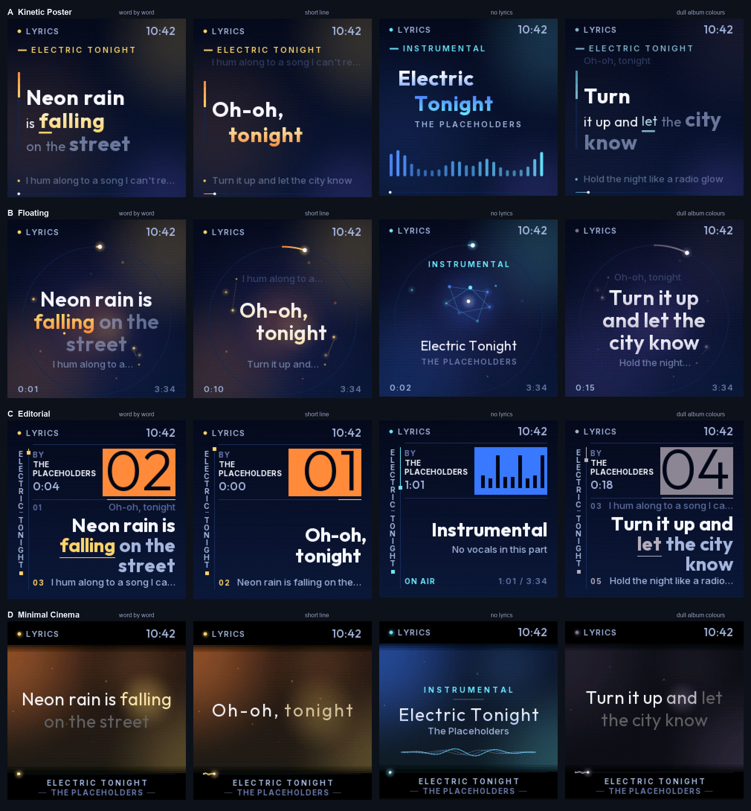

<sub>All lyrics in these images are made up.</sub>

### Performance

- **Redraw while a word is sung:** only the words that changed are redrawn.
- **Line change:** the lyrics block redraws for about a third of a second.
- **Hero font:** Outfit 28 (bold), stored in flash (14.6 KB). It costs no memory.
- **Memory:** about 0.8 KB, for the line window, the word timings and two cached layouts.

### Limits

- **Fonts are A–Z only.** Songs available only in other scripts show "Lyrics in another script".
- **Coverage depends on LRCLIB.** Unknown songs show the title poster. Podcasts never show lyrics.
- **Very fast rap** can sit on the last line the clock has for about half a second at times, until the next check.
- **Network drops:** if the Wi-Fi drops, the page keeps the last lines it received until the relay answers again.
- **Timing source:** the timing is what the uploader recorded on LRCLIB. A song can be slightly early or late.

## Mining (hobby)

The clock can mine [Duino-Coin](https://duinocoin.com) (DUCO), a coin made for small boards. **It doesn't make
money.** An ESP8266 earns small amounts of DUCO worth a tiny fraction of a rupee a day, and its power costs
more than that. It's here for the fun of watching it work, and every number shown is real.

| Coin | On this clock |
|---|---|
| Duino-Coin | Works: about 30–40 kH/s in the clock's spare time (0.9.4+); earns fractions of a cent a day |
| Bitcoin | Possible only as a lottery: the odds of finding a block are around 1 in quadrillions per day, so the page just shows them |
| Monero, Ethereum Classic and others | Can't run: their algorithms need far more memory than the clock's ~11 KB |

**Turn it on:**
1. Create a free account at [duinocoin.com](https://duinocoin.com) (a web wallet).
2. On the settings page, open **Feeds**, **Mining**: enter your Duino-Coin username, an optional mining key
   (if you set one in your wallet), and a rig name (default `caiden`). Press **Save account**.
3. Switch **Mine Duino-Coin** on. The **Mining** page joins the rotation.

**How it behaves:**
- **Background only:** it hashes in slices of 6 ms between screen updates (15 ms while the page is still), so pages, the web page and updates
  stay as smooth as before.
- **Automatic pauses:** it stops during firmware updates and pauses when free memory drops below 8 KB or Wi-Fi is
  weaker than -85 dBm.
- **Mining page:** an animated crystal mine; see [What's new](#whats-new) for the animation.
  - Coins fly into a mine cart for accepted shares, and the miner says "Oops" for rejected ones.
  - Below: hash rate, shares, a 24-hour line, today's INR value and your total, and the Bitcoin odds.
- **Header badge:** a small gold pickaxe in every page header (grey while paused), next to the Spotify equaliser.
- **Settings page:** the same numbers, the pool's own view of your rig, and a 24-hour chart.
- **Remote check:** the relay's `/clock.json` also shows the hash rate and shares.
- **Measure it yourself:** with USB, `python -I tools/serial_cmd.py '{"cmd":"minebench"}'` (from `firmware/`)
  prints the raw hashing speed (about 54.7 kH/s on 0.9.4). The real rate is lower because the clock only mines
  in its spare time.
- **Earnings stay small:** Duino-Coin lowers the reward per share as a device gets faster, so more hash rate
  raises DUCO only a little.
- **Privacy:** your username and mining key stay in the clock's settings. The relay looks up your public Duino-Coin
  balance for the earnings line.

## Updates

After the first install, new versions don't need the cable. You build an image on your PC, sign it with your
clock's own key, publish it to your relay, then press **Install** on the settings page. The clock downloads it
(about 40 seconds), checks the signature and checksum, and restarts. A failed download changes nothing.

Full steps, including the one-time key setup and home-network updates: [docs/UPDATES.md](docs/UPDATES.md).

Check what the clock runs, from anywhere: `http://<your relay>/clock.json`.

## Security and privacy

- **Settings page:** locked with a password that the clock makes itself and shows on its System screen.
  Five wrong guesses lock login for a while. The page uses plain HTTP (the chip can't do HTTPS), so use it on a
  Wi-Fi network you trust.
- **Updates:** only images signed with your clock's own secret key (`firmware/tools/ota_key.txt`, kept on your
  PC) install, only newer versions, and only after you press Install.
- **Your relay** runs on your own Cloudflare account. Spotify sign-in, keys and the update image live there.
  Anyone who knows its address can read the same public data, your current Spotify track and the health
  report, so don't publish the address.
- **Never commit or share:**
  - `backups/`: the stock firmware dump holds your Wi-Fi password;
  - `firmware/tools/ota_key.txt`;
  - `relay/wrangler.toml`;
  - your `ADMIN_KEY` and `CRICKET_KEY`.

  `.gitignore` already excludes the files; the keys live only in Cloudflare.
- **Setup network:** WPA2, with a random password shown on the clock.

## Troubleshooting

| Problem | Try |
|---|---|
| `esptool` can't connect | Use a data cable (not charge-only), another USB port, and `--baud 115200`. Unplug and replug. |
| `caiden.local` doesn't open | Use the IP address from the clock's System screen. Some Android versions don't resolve `.local` names. |
| Clock shows the setup screen | It can't reach the saved Wi-Fi (wrong password, 5 GHz-only network, out of range). Set it up again (Install step 3). |
| News, markets or quote missing | Check the relay address under **Feeds**, then open `http://<relay>/state.json` in a browser. |
| Spotify stays empty | Repeat the Spotify sign-in link from the relay guide; check the Redirect URI matches your relay exactly. |
| Lyrics page never appears | It rotates only while a song with synced lyrics plays. Check **Pages** has Lyrics on, the relay is redeployed (1.0.0+ relay), and open `http://<relay>/sp.json?ly=1` while playing: `lk` 1 means lyrics were found. |
| Update fails | Check `http://<relay>/clock.json` for `ue` (the last update error). A weak Wi-Fi signal (`ss` below -80) slows or breaks downloads. |
| Anything else | Read the clock's log over USB: `python -I tools/serial_cmd.py '{"cmd":"status"}'` from `firmware/`. |
| Want the stock firmware back | [docs/BACKUP_AND_RESTORE.md](docs/BACKUP_AND_RESTORE.md#restore) |

## Project layout

```
firmware/              CAIDEN OS (PlatformIO, Arduino core for ESP8266)
  src/                 display driver, graphics engine, screens, Wi-Fi, services
  portal/index.html    the settings page (built into the firmware by tools/gen_portal.py)
  tools/               install, Wi-Fi setup, update and debug scripts
  fonts/               where to get the fonts, if you want to change them
relay/                 the Cloudflare Worker (worker.js) and its setup guide
docs/                  hardware, backup/restore and update guides; images for this README
```

## Credits and licence

Weather and air quality: [Open-Meteo](https://open-meteo.com/). News: BBC and The Hindu RSS feeds and Bing News search. Markets: Yahoo Finance and
CoinGecko. Quotes: ZenQuotes. Cricket: ESPNcricinfo's live-score feed or [CricketData.org](https://cricketdata.org/).
Album art resizing: [wsrv.nl](https://wsrv.nl/). Lyrics: [LRCLIB](https://lrclib.net), a free and open
lyrics database built by its community. Fonts: Inter, Outfit, Ubuntu and Source Code Pro.

Code: [MIT licence](LICENSE). The fonts keep their own licences (SIL OFL 1.1 and the Ubuntu Font Licence).
